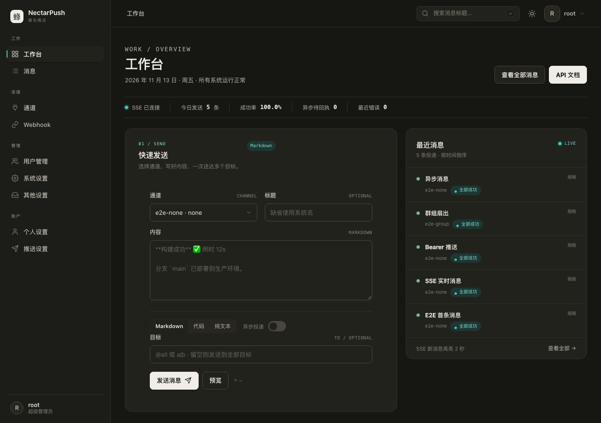

# NectarPush · 蜂鸟推送

> 多渠道消息推送服务：一次写入，分发到邮件、Telegram、Discord、钉钉、飞书、Bark 等通道。
> 单端口 Docker 部署，自带 Web 工作台、Webhook 触发、OAuth2 登录与实时消息流。

**NectarPush** is a self-hosted, multi-channel message push service. Write once, deliver to
email, Telegram, Discord, DingTalk, Lark, Bark and more — with a built-in web workbench,
webhook triggers, OAuth2 login and a real-time event stream, shipped as a single-port Docker image.

[](https://github.com/leunghope/nectarpush/actions/workflows/ci.yml)
[](LICENSE)




---

## 特性

- **多渠道分发** —— 10 个核心通道（邮件 / Telegram / Discord / 钉钉 / 飞书 / Bark / 自定义 HTTP / WebSocket 客户端 / 群组 / 不推送），一条消息可同时投递到多个目标。
- **Web 工作台** —— 仪表盘、快速发送、消息管理、通道管理、用户与系统设置，深色 / 浅色双主题。
- **Webhook 触发** —— 每个通道一条不可预测的触发 URL，支持 JSONPath（从 JSON 里按路径取值）与模板规则，把第三方事件转成推送。
- **实时消息流** —— SSE（服务器到浏览器的单向长连接，`/api/events`）按用户隔离推送 `message.created` / `delivery.updated`；WebSocket 客户端通道双向收发。
- **异步推送** —— `async=true` 立即返回消息 UUID（消息的唯一编号），随后查询投递状态与回执。
- **OAuth2 登录** —— 卡片式表单管理提供方，内置 GitHub 预设 + 自定义 OIDC 提供方（任何支持 OIDC 的登录服务）；首次登录强制改密。
- **安全默认** —— 通道凭据 AES-256-GCM 加密、接口不返回明文、自定义通道防 SSRF（阻止服务端被诱导访问内网地址）、Markdown 渲染防 XSS（阻止注入脚本）、分级限流。
- **单端口部署** —— 接口与网页由同一个进程提供，一个 Docker 镜像 + 一个数据卷即可运行。

## 快速开始

需要 Docker。官方镜像发布在 GitHub 容器仓库，支持 `linux/amd64` 与 `linux/arm64`。

### 方式一：直接拉取预构建镜像（最快）

```bash
docker run -d --name nectarpush \
  -p 3000:3000 \
  -v nectarpush-data:/data \
  -e SESSION_SECRET=$(openssl rand -hex 32) \
  -e ENCRYPTION_KEY=$(openssl rand -hex 32) \
  ghcr.io/leunghope/nectarpush:latest
```

想用 compose 管理，把环境变量写进 `.env` 后拉取即可，不必本地构建：

```bash
git clone https://github.com/leunghope/nectarpush.git
cd nectarpush/deploy

cat > .env <<EOF
SESSION_SECRET=$(openssl rand -hex 32)
ENCRYPTION_KEY=$(openssl rand -hex 32)
PORT=3000
EOF

docker compose pull && docker compose up -d --no-build
```

### 方式二：从源码构建

```bash
git clone https://github.com/leunghope/nectarpush.git
cd nectarpush/deploy
export SESSION_SECRET=$(openssl rand -hex 32)
export ENCRYPTION_KEY=$(openssl rand -hex 32)
docker compose up -d --build
```

打开 <http://localhost:3000>，使用 `root / 123456` 登录，按提示**强制修改密码**后进入工作台。

> 数据保存在 `nectarpush-data` 卷（容器内 `/data/nectarpush.db`）。重启 / 重建容器不丢数据；`docker compose down -v` 会清空全部数据。完整部署、反向代理、备份与升级见 [docs/DEPLOYMENT.md](docs/DEPLOYMENT.md)。

## 文档

| 文档 | 内容 |
| --- | --- |
| [docs/API.md](docs/API.md) | 面向使用者的 API 指南：认证、推送、各资源 CRUD、实时、错误码 |
| [docs/openapi.yaml](docs/openapi.yaml) | OpenAPI 3.1 接口定义（以此为准） |
| [docs/api-examples/](docs/api-examples/) | 可执行的 REST Client 与 curl 示例 |
| [docs/DEPLOYMENT.md](docs/DEPLOYMENT.md) | 部署、环境变量、反向代理 / TLS、备份还原、升级回滚 |

## 技术栈

NestJS 11（Fastify 5 适配器）· Prisma 6（SQLite 默认）· React 18 · Vite 6 · Tailwind CSS 3 · TypeScript 5.6 · Node 22 · pnpm 10。

## 通道支持

**核心通道（10）**

| 类型 | 名称 | 实测发送 |
| --- | --- | --- |
| `none` | 不推送（只存入数据库） | ✅ 已验证 |
| `group` | 群组分发 | ✅ 已验证 |
| `email` | 邮件（SMTP） | ✅ 已验证 |
| `telegram` | Telegram | ⚠️ 只测过发送失败的情况 |
| `discord` | Discord | 未实测 |
| `ding` | 钉钉 | 未实测 |
| `lark` | 飞书 | 未实测 |
| `bark` | Bark | 未实测 |
| `custom` | 自定义 HTTP | 未实测 |
| `client` | WebSocket 客户端 | 未实测 |

**占位通道（6 个，`status: draft`，还没接入真实服务）**：`test`、`corp_app`、`corp`、`lark_app`、`one_bot`、`tencent_alarm`。只有配置界面和占位实现，**不可用于生产**。

> 「未实测」指还没用真实凭据实际发送并确认对方收到；接口与配置已经就绪，欢迎反馈实测结果。

## 开发

```bash
pnpm install --frozen-lockfile
pnpm --filter api dev      # API（默认 http://127.0.0.1:3000）
pnpm --filter web dev      # Web（Vite 开发服务器）

pnpm run verify            # 一键检查：类型检查 → 构建 → 单元测试 → 端到端
```

`scripts/verify.sh` 依次执行：Web 类型检查 → 构建（API + Web）→ API 单元测试 → Web 单元测试 → Playwright 端到端测试。端到端测试直接启动构建产物，所以必须放在构建之后。

## 已知限制

- 当前版本只在 **SQLite** 上测试过；切换到 MySQL / PostgreSQL 需要自行修改 Prisma datasource 并生成迁移，未做测试。
- 6 个占位通道还没接入真实服务；多数核心通道也还没用真实凭据实测发送（见上表）。
- 镜像不处理 TLS；公网 HTTPS 需要自行在镜像前加一层反向代理（见部署文档）。

## 名词解释

| 词 | 说明 |
| --- | --- |
| 通道 | 一个推送目的地，例如一个邮箱、一个群机器人或一个 Webhook 地址。 |
| 推送令牌 | 调用推送接口时用来证明身份的字符串，相当于这个接口的密码。 |
| Webhook | 一个由本服务生成的 URL；外部系统一调用它，就会触发一次推送。 |
| SSE | 服务器到浏览器的单向长连接，有新消息时主动推给页面；工作台的实时刷新用它。 |
| WebSocket | 浏览器与服务器之间的双向长连接，可以收发消息。 |
| OAuth2 / OIDC | 用 GitHub 等第三方账号登录，不必在本站另设密码。 |
| JSONPath | 从 JSON 数据里按路径取值的写法，例如 `repository.full_name`。 |
| UUID | 消息的唯一编号，用于查询状态或分享链接。 |
| 反向代理 | 放在应用前面的服务器（如 nginx），负责域名、HTTPS 和转发请求。 |
| 数据卷 | Docker 管理的持久化目录；删除数据卷等于删除全部数据。 |
| TLS | 网页的加密传输协议，也就是地址栏里的 `https://`。 |
| CORS | 浏览器限制「哪些网站可以带登录状态调用接口」的机制。 |
| XSS / SSRF | XSS 是往页面注入恶意脚本；SSRF 是诱导服务器去访问内网地址。 |
| 端到端测试 | 用真实浏览器把主要流程完整跑一遍，简称 e2e。 |
| 占位通道 | 只做了配置界面、还没接入真实服务的通道，不能用于生产。 |

## 致谢

NectarPush 参考了 [songquanpeng/message-pusher](https://github.com/songquanpeng/message-pusher)（MIT）的功能设计，从零独立实现，代码与该仓库无关。感谢原作者带来的灵感。

## 许可证

[MIT](LICENSE) © NectarPush Authors